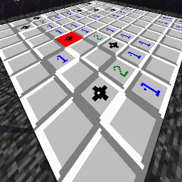

# 💣 Retro Minesweeper (Minecraft NeoForge 1.21.1)

> **Author:** Durhol  
> **Platform:** Minecraft 1.21.1 (NeoForge 21.1.259+)  
> **License:** MIT  

---

## 🇷🇺 О моде (Русский)

**Retro Minesweeper** переносит легендарную классическую механику Windows «Сапёр» (Windows 95 / XP) прямо в Minecraft внутри изолированного карманного измерения (`minesweeper:game_world`).

Крафтите специальное портативное устройство, активируйте его и отправляйтесь на парящую арену сапёра. Ваш инвентарь будет надежно сохранён на время игры, а взамен вы получите фирменные инструменты: сапёрную лопатку, флаг и предмет выхода!

### ✨ Ключевые особенности
- 🎮 **3 Уровня сложности (Tiers):**
  - **Tier 1 (Beginner):** Сетка $9 \times 9$, 10 мин. Награда: **1x Алмаз** 💎.
  - **Tier 2 (Intermediate):** Сетка $16 \times 16$, 40 мин. Награда: **5x Алмазов** 💎💎💎💎💎.
  - **Tier 3 (Expert):** Сетка $30 \times 16$, 99 мин. Награда: **2x Незеритовых слитка** 🪙🪙.
- 🛡️ **Гарантированный безопасный первый клик:**
  - Мины генерируются строго *после* первого вскапывания — первая нажатая плитка и все 8 клеток вокруг неё никогда не содержат мин!
- 🌊 **Рекурсивное раскрытие (Flood Fill):**
  - При попадании на пустую ячейку (0 мин рядом) автоматически волной открываются все прилегающие свободные зоны.
- 🚩 **Контроль флагов:**
  - Максимум флагов строго равен числу мин — счетчик не уйдет в минус. Флагнутые клетки защищены от случайного копания.
- 🎨 **Ретро-стилистика Windows 95/XP:**
  - Объёмные плитки-кнопки, оригинальные цветные цифры 1–8, чёрные шипастые мины и подорванная мина на красном фоне.
- 🎵 **Кастомный саунд-дизайн:**
  - Звук старта игры, щелчок открытия клетки, установка флага, победный саундтрек и звук поражения!
- 💥 **Анимация взрыва и осмотр поля при поражении:**
  - При подрыве на мине срабатывает визуальный взрыв и дым над всеми минами, но вас не выкидывает сразу! Вы можете спокойно изучить поле и посмотреть, где вы ошиблись, после чего выйти через предмет *Forfeit & Exit*.
- 🔒 **Защита арены и инвентаря:**
  - Блоки на арене абсолютно неразрушимы (свойства бедрока), выбрасывать инструменты нельзя, ваш исходный инвентарь автоматически возвращается при завершении игры.

### 🔨 Крафт устройств

#### Tier 1 Device (Beginner):
- 1 TNT
- 1 Алмаз
- 2 Железных слитка
- 1 Золотой слиток
- 4 Редстоун пыли

---

## 🇬🇧 About the Mod (English)

**Retro Minesweeper** brings the legendary classic Windows Minesweeper experience (Windows 95 / XP style) directly into Minecraft inside a dedicated pocket dimension (`minesweeper:game_world`).

Craft a portable Minesweeper Device, right-click to enter, and test your wits on a floating void arena. Your personal inventory is safely stashed away during the match, and you are provided with authentic temporary tools: the Trowel, the Flag, and the Forfeit/Exit tool!

### ✨ Key Features
- 🎮 **3 Difficulty Tiers:**
  - **Tier 1 (Beginner):** $9 \times 9$ grid, 10 mines. Victory Reward: **1x Diamond** 💎.
  - **Tier 2 (Intermediate):** $16 \times 16$ grid, 40 mines. Victory Reward: **5x Diamonds** 💎💎💎💎💎.
  - **Tier 3 (Expert):** $30 \times 16$ grid, 99 mines. Victory Reward: **2x Netherite Ingots** 🪙🪙.
- 🛡️ **Guaranteed Safe First Click:**
  - Mine distribution is generated strictly *after* your first click — the initial clicked tile and all 8 surrounding neighbors are 100% mine-free!
- 🌊 **Recursive Flood Fill:**
  - Digging a zero-adjacent cell automatically reveals adjacent clear regions recursively.
- 🚩 **Strict Flag Cap:**
  - Flag count cannot exceed total mine count — your mine counter never drops into negative numbers. Flagged tiles are protected from accidental clicks.
- 🎨 **Authentic Windows 95/XP Visuals:**
  - 3D beveled unpressed buttons, classic colored digits 1–8, spiked retro mines, and exploded mine red highlight.
- 🎵 **Custom Sound Design:**
  - Unique sound effects for game start, cell digging/clicking, flag placement, victory fanfare, and defeat explosion!
- 💥 **Explosion Animation & Post-Game Field Inspection:**
  - Triggering a mine produces explosion particles and smoke over all hidden mines without instantly ejecting you. You can walk around, analyze the revealed board, and leave whenever ready via the *Forfeit & Exit* tool.
- 🔒 **Arena & Inventory Protection:**
  - Arena tiles have bedrock-tier blast resistance, tool dropping is prohibited, and your original inventory is automatically restored upon return.

### 🔨 Crafting Recipes

#### Tier 1 Device (Beginner):
- 1 TNT
- 1 Diamond
- 2 Iron Ingots
- 1 Gold Ingot
- 4 Redstone Dust

---

## 🚀 Установка / Installation

1. Install [Minecraft 1.21.1](https://www.minecraft.net/) and [NeoForge](https://neoforged.net/) `21.1.259+`.
2. Download `minesweeper-1.0.0.jar` from the [Releases](https://github.com/Durhol/minesweeper/releases) page or [Modrinth](https://modrinth.com/).
3. Place the `.jar` into your `.minecraft/mods/` directory.
4. Launch Minecraft and enjoy!
